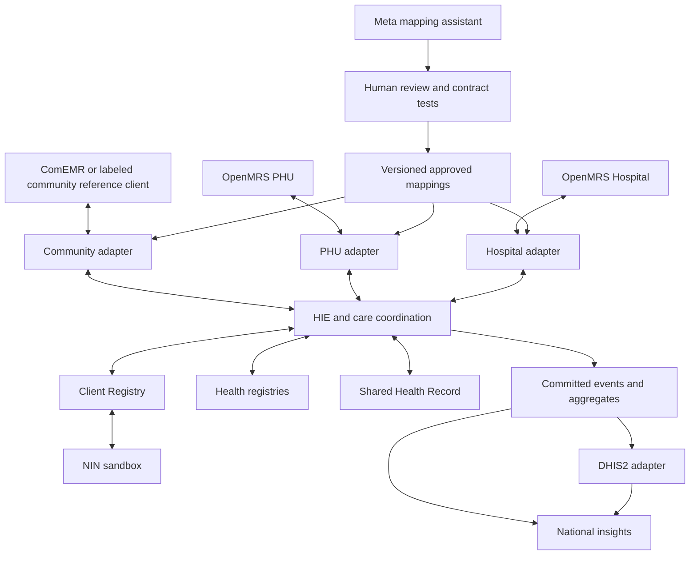

# DPI Health Connect build plan

## Product and competitive focus

The DPI-H workshop established the architectural blueprint and patient journey through a concept demonstration. No real patient data was captured in ComEMR or exchanged with another application. The hackathon addresses the implementation gap: connecting independent applications through shared infrastructure, preserving the meaning of exchanged data, and making those connections easier to deploy and maintain. Refer to the workshop as design groundwork, not an existing operational integration or evidence of government endorsement. Use synthetic records to prove actual application-to-application exchange in the new build.

Build a narrow but complete implementation of shared health infrastructure. Demonstrate that an assessment entered in one application can be understood, persisted and acted on in another, with a traceable return path. The primary AI feature is a Meta-powered interoperability workbench: it proposes mappings from a source application's fields and concepts to a shared contract, explains ambiguity and validates proposals against examples before a person approves them.

The defining demonstration is a schema change. A source application changes its blood pressure format; the existing adapter rejects the incompatible event. Muse Spark proposes a corrected mapping, the operator reviews a before-and-after preview, automated checks pass, and the original event is replayed successfully without editing the receiving applications. This demonstrates a practical way to reduce integration maintenance. It does not imply that AI can integrate any system automatically or eliminate all downstream changes.

Recommended positioning: Startup track, Build for Your World, subject to the track in Kenneth's accepted registration. The signed-in guide confirms impact 30%, Meta AI tooling 25%, technical depth and execution 20%, and demo 25%. Build evidence for each: beneficiary and maintenance cost, a verifiable model-driven repair workflow, persisted exchanges with recovery, and a strong three-minute demonstration. [Participant Guide](https://cerebralvalley.ai/e/meta-ai-developer-hackathon/details)

## Scope and proof boundaries

| Component | Hackathon commitment | Evidence required |
| --- | --- | --- |
| ComEMR community application | Integrate an authorized development instance if its API and write access are available | Saved assessment and referral obtained through its actual API |
| PHU and hospital applications | Two isolated OpenMRS instances with separate databases and local patient IDs | Referral and observations persisted and visible in both applications |
| Client Registry | Persistent identifier crosswalk and deterministic exact matching; ambiguous cases require review | One shared patient identity mapped to three local records |
| Health registries | Seeded facility, provider, service capability and terminology references behind APIs | Validated IDs and rejection of unknown references |
| HIE plus care coordination | Contract validation, routing, delivery receipts, referral lifecycle and retries | Correlated trace from capture through receiver persistence and return update |
| Shared Health Record | Persistent FHIR R4 store with source attribution and resource history | Timeline survives restart and reads show original authors and sources |
| Meta mapping assistant | Real runtime model calls, review interface and versioned mappings | Model request metadata, approved mapping, test result and successful replay |
| National insight | Aggregates computed from committed events | Values reconcile to the underlying synthetic dataset |
| DHIS2 | Add real aggregate export and readback after the core flow works | Stored values and import receipt; otherwise label the connector unimplemented |
| NIN, NEMS, blood bank and insurance | Explicitly labeled sandbox services; narrow sample contracts | Repeatable local responses, without claims of national service connectivity |

ComEMR 3.0.0 is private. Kenneth has its source as a contributing developer and can run it locally with Docker. Its source will not be included in the public submission. Build an independently implemented community simulator as the reproducible judging path, and support local ComEMR as an optional integration target. Both targets use the same connector interface and versioned contract tests. Describe the simulator as a community API simulator, not an official ComEMR distribution.

Confirm which API details may be published before committing schemas or fixtures derived from the private system. Possession of source does not establish redistribution permission. Keep private source, images, database dumps, credentials and proprietary UI assets outside the public repository. Use only synthetic fixtures and independently written simulator code. If a faithful API contract cannot be published, expose our own public community contract and keep the ComEMR-specific translation adapter private; document that limitation rather than claiming full API compatibility.

Define compatibility for the supported journey endpoints only: authentication behavior, patient lookup and registration, assessment creation/readback, referral submission/status and follow-up updates, as supported by the actual application. Verify endpoint paths, payloads and capabilities locally rather than inventing them. Test identifiers, required fields, units, errors, pagination where used, duplicate submissions and response-loss retries against both targets. Normalize only documented nondeterministic fields when comparing results. Do not promise equivalence across the entire ComEMR product or assume its offline synchronization works like the simulator.

Select the target through server-side configuration (community backend mode, base URL and credentials); keep downstream mappings and HIE workflow unchanged where the contracts match. Judge setup must start the simulator without access to ComEMR source, images or credentials. Store test results by backend and version. Label live ComEMR runs separately from simulator runs in the console, README and video. Demonstrate only the new connector functionality when showing the existing application.

The earlier workshop hospital label was National EMR, demonstrated with CARE. For this build, the proposed real hospital backend is OpenMRS, as discussed for interoperability. Label the actual implementation honestly; CARE integration is a later extension.

Ancillary data services, HCM, PResTrack, Pikin App, mSupply and surveillance can appear as planned connectors in architecture views. Do not animate them as live connections without an implemented endpoint. Health insurance is a sandbox eligibility response only, not an automated coverage decision.

## Architecture and implementation choices

Use React, TypeScript and Vite for the console, Node.js and TypeScript for the core APIs and worker, PostgreSQL for registry crosswalks, workflow state, mappings, audit metadata and an outbox. Use HAPI FHIR JPA with PostgreSQL for the Shared Health Record, and Docker Compose for reproducible startup. Pin stable versions after the day-one compatibility test. OpenMRS instances retain their own databases. These are proposed implementation choices, not installed services.

Reuse established FHIR storage rather than write a new FHIR server. HAPI documents its JPA server foundation; OpenMRS provides REST APIs, but actual resource support must be tested against the chosen distribution and modules. Use OpenMRS REST adapters where necessary; do not assume full FHIR support from the product name. [HAPI server documentation](https://hapifhir.io/hapi-fhir/docs/server_jpa/get_started.html) · [OpenMRS REST reference](https://rest.openmrs.org/)

Logical separation matters more than deploying many microservices in ten days. Registry and workflow modules can share one backend deployment while keeping separate APIs and authorization boundaries. No direct writes into another application's database. All exchanged clinical data goes through the HIE adapters.

FHIR resource scope: Patient, Encounter, Observation, ServiceRequest, Task, Organization, Location, Practitioner, PractitionerRole, RelatedPerson and Provenance. Record identity namespaces, UCUM units, source codes and approved terminology mappings. Model blood pressure with systolic and diastolic components. Preserve unmapped concepts for review rather than inventing codes. Maternal and newborn records are distinct patients with an explicit relationship.

Each event contains an event ID, schema version, source system, source record/version, patient reference, occurrence time, correlation ID, causation ID and payload. Persist workflow changes and the outbound event in one transaction. Workers deliver with at-least-once semantics, exponential backoff and idempotent receiver operations. Persist receiver IDs before displaying success. A retry must not create a second referral, encounter or aggregate count. Quarantine invalid messages and show a reason plus a controlled replay action.

Client lookup first searches stored patient identifiers and NIN links. Only unresolved identity verification calls the NIN sandbox. Cache a verified linkage with its provenance. Unknown NINs do not block provisional care registration. Conflicting identifiers and demographic near-matches are held for review, never silently merged by a model.

## Meta models and AI design

Use Muse Spark through Meta Model API as the required runtime AI dependency. The current documentation lists `muse-spark-1.3` and an API base of `https://api.meta.ai/v1`; verify availability in the participant account before pinning the model. Keep the API key server-side and log model ID, prompt version, latency, usage and result status. [Meta API documentation](https://dev.meta.ai/docs/overview)

The assistant receives source schemas, synthetic examples, target profiles and a small approved terminology catalog. It returns a constrained mapping specification: source path, target path, transform from an allowlist, code mapping, uncertainty and evidence. It can inspect schemas, call validators, inspect failures and revise a proposal within a bounded loop of at most three attempts. It cannot deploy mappings, merge identities, alter patient records or execute arbitrary generated code. Human approval creates a versioned mapping; the deterministic engine handles all subsequent exchanges. This engineering workflow is the AI product feature. The guide prohibits AI-generated medical advice; no model will diagnose, recommend treatment or decide clinical referrals.

Example: map `bp: "160/106"` and explicit `mmHg` to two blood-pressure components. A missing unit, contradictory identifier or unknown concept must cause a review request. Schema-valid JSON is insufficient: validate values, semantics, references, required fields and unit transformations against independent expected results.

Muse Wonder is optional for comparing difficult mapping cases after Spark works. Muse Voice Transcribe is a stretch feature for faithful transcription of an English spoken assessment for CHW confirmation, without advice or inferred clinical facts; do not assume Krio support. Muse Image and SAM have no essential role in this proof and should not consume the critical path. The guide's viability screen requires meaningful use of Meta Model API and/or Meta open-weight models, not every model on the list.

Use hosted inference first. Meta describes Glimmer as 30B parameters; 4-bit weights alone would be roughly 15 GB before runtime overhead, so the previously stated 8 GB GPU memory is not a dependable deployment target. Spark Open is also outside this machine's practical scope. Offline operation refers to queued care events and already-approved mappings, not a claim that hosted AI works without connectivity. [Muse Glimmer](https://dev.meta.ai/models/muse-glimmer)

Set an initial planning cap of US$50 in API usage, subject to available credits and Kenneth's spending authorization; this plan does not authorize purchases. Track actual usage and cap output, retries and model calls. Approved mappings should avoid a model call per clinical transaction.

## Patient journey and demonstration

Use synthetic Aminata Kamara at 37 weeks, Isatu in Kamanka, Binkolo CHC and Makeni Government Hospital. The recorded danger signs and hospital intervention are authored scenario facts, not AI-generated clinical recommendations.

1. Isatu captures an assessment containing high BP, bleeding and a clinician-authored referral reason. Show the record saved at its source and queued while disconnected.
2. Reconnect. Resolve the shared identity, validate the assessment, persist it in the Shared Health Record and deliver the referral to Binkolo OpenMRS. Open the receiver's record to prove persistence.
3. The PHU records its assessment and need for hospital capability. A major referral reaches the separate hospital instance. A labeled NEMS sandbox dispatch supplies a simulated ETA; 117 remains the scenario number confirmed by DPPI, not a live call.
4. The hospital records delivery and creates a separate baby record. Link mother and baby, and show sandbox NIN registration. Return the outcome to community follow-up and show the six-week postnatal record.
5. National indicators update from committed events: ANC encounters, referrals, completed transfers and births. Commodity stock uses a separate seeded inventory ledger and explicitly simulated movements, not invented clinical-event inference.
6. Introduce the schema-change challenge. Show rejection, Meta's proposed repair, validation, operator approval and successful replay. The receiver code stays unchanged.

Deliver the required three-minute submission video and prepare an optional five-minute walkthrough. Show only new hackathon functionality; the workshop is background context, not demo footage. Proposed video allocation: 0:00–0:15 problem and new contribution; 0:15–0:55 persisted patient exchange; 0:55–2:10 schema break, Meta tool calls, validation, approval and replay; 2:10–2:40 outage recovery and return update; 2:40–3:00 measured results and product path. The repository must be public, and video and live product must be accessible to judges.

The console has three views: patient timeline, integration workbench and live system trace. A map is optional after the proof works. Trace lines illuminate from actual events and distinguish queued, validated, delivered and failed states. Display sandbox endpoints clearly. A recorded replay is labeled as a replay and never presented as a live API call.

## Delivery schedule in Freetown time

| Date | Main deliverable | Exit condition |
| --- | --- | --- |
| Oct 26 | Planning, access preparation and initial implementation after kickoff | Record actual timestamps, dependency needs and initial connector contracts |
| Oct 27 | Model smoke test, runtime setup, contracts and first receiver adapter | Meta response and synthetic patient/observation persistence verified; time-box setup |
| Oct 28 | Community to PHU vertical slice | Source capture reaches PHU through HIE with matching identifiers |
| Oct 29 | Meta mapping workbench | Model proposes mapping, operator approves, deterministic exchange passes |
| Oct 30 | Hospital and return journey | Two independent EMRs exchange referral and delivery outcome |
| Oct 31 | Offline queue and failure recovery | Restart, retry and duplicate tests pass without duplicate records |
| Nov 1 | National aggregates and DHIS2 if feasible | Dashboard totals reconcile; optional DHIS2 values read back |
| Nov 2 | Evaluation and feature freeze | Held-out tests scored, baseline comparison recorded, scope fixed |
| Nov 3 | Record, package and rehearse | Clean setup succeeds; evidence and demo video complete |
| Nov 4 | Final review and submission | Internal target 18:00 GMT, with confirmation receipt retained |

The participant deadline is November 4 at 9 PM Eastern, which is November 5 at 02:00 in Freetown. The internal target leaves an eight-hour buffer. The guide lists October 27–November 4 as the building period, while the event overview and announcements establish an October 26 kickoff. No explicit prohibition on coding after kickoff was found. Proceed under Kenneth's build instruction, preserving actual timestamps and documenting this schedule discrepancy. [Participant schedule](https://cerebralvalley.ai/e/meta-ai-developer-hackathon/details)

If the end-to-end exchange is not working by October 28, stop visual polish and all optional integrations. If the Meta mapping assistant is not working by October 29, make it the only new feature until it passes. Drop voice, extra systems and a full 3D scene before dropping real writes, evaluation or delivery recovery.

## Evaluation and acceptance

Targets below are acceptance goals, not achieved results.

- Prepare 30 held-out mapping cases across three source schemas: 20 valid variations and 10 ambiguous, conflicting or invalid inputs. Keep expected outputs independent from prompts. Score exact fields, units, concepts and correct abstention. Report denominators and failure examples.
- Require every activated mapping to pass its contract tests. Target at least 18 of 20 valid cases correctly proposed and all 10 unsafe or ambiguous cases blocked from automatic activation. Report raw proposal quality separately from accuracy after human correction.
- Compare manual mapping and AI-assisted mapping on equivalent unfamiliar schemas, using the same engineer and counterbalanced task order where feasible. Record time to a passing mapping, human edits, model latency and cost. With a small sample, report observed timings rather than universal ROI claims.
- Run ten complete patient journeys and assert persisted destination IDs, longitudinal history, mother-baby linkage and reconciled counts. Inject duplicate events, lost responses, reordered updates, a receiver outage and a worker restart.
- Disconnect the community client, capture an event, restart it, reconnect and prove delivery once. If using a reference client, limit the offline claim to that client; ComEMR's own synchronization behavior needs separate verification.
- Test unauthorized facility access, invalid credentials, prompt injection in a schema description, malicious transform text and model timeout. Approval is bound to a mapping content hash and version to prevent later substitution.
- Compute p50/p95 delivery latency and per-mapping model cost from measured runs. Separate model proposal latency from routine data-transfer latency. Do not announce an SLA from a local prototype.

Keep synthetic data visibly separate from production. Apply facility-scoped permissions and audit access and mapping approvals. Verify the browser bundle and logs contain no secrets. A FHIR store alone does not supply the access controls, consent governance and operating procedures needed for national deployment.

## Product path and pitch

The first customer hypothesis is an implementation partner or health ministry team onboarding and maintaining existing digital health applications. The deliverable is a deployable integration toolkit with approved mapping catalogs and traceable operations. Validate demand by documenting current onboarding steps and reviewing the working proof with a technical stakeholder; do not claim an endorsement, procurement agreement or health outcome improvement.

The final pitch should establish a known maintenance problem, demonstrate a working cross-system journey, show what Meta contributes, quantify measured engineering improvement and explain the next pilot. Distinguish this work from existing HIE tools through the evaluated mapping workflow and understandable evidence of data movement. Open standards and reusable connectors provide the route beyond one country; national adoption remains future work.
